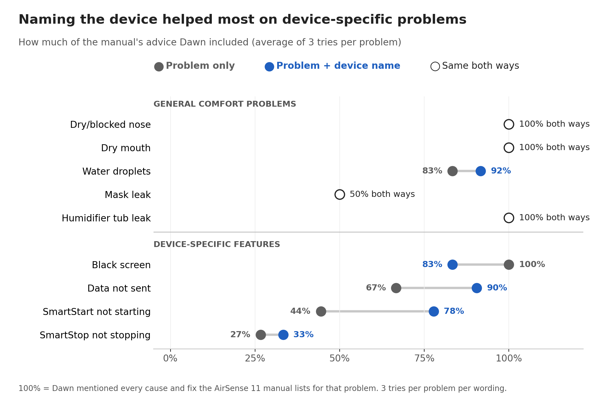
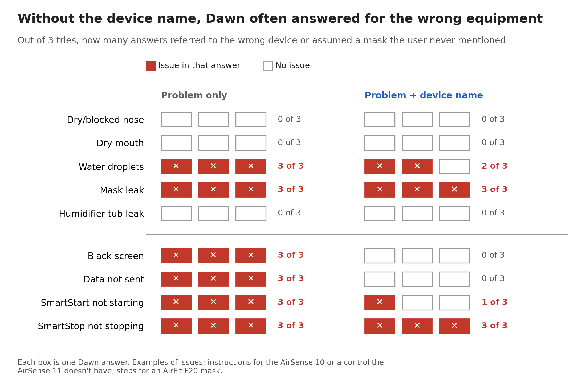
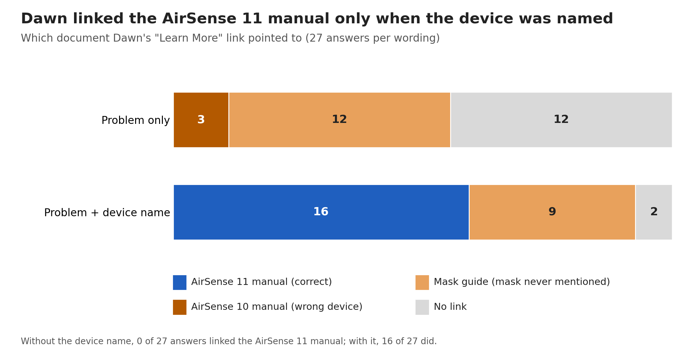
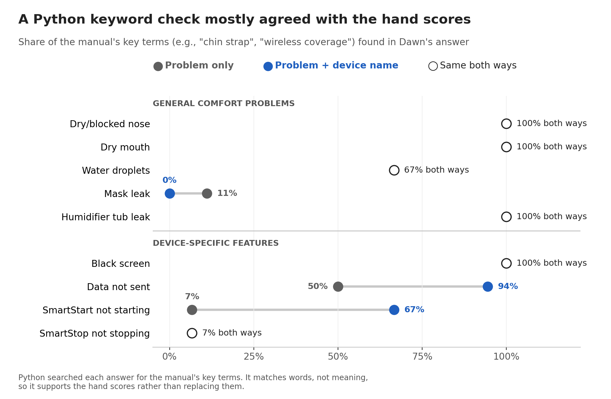
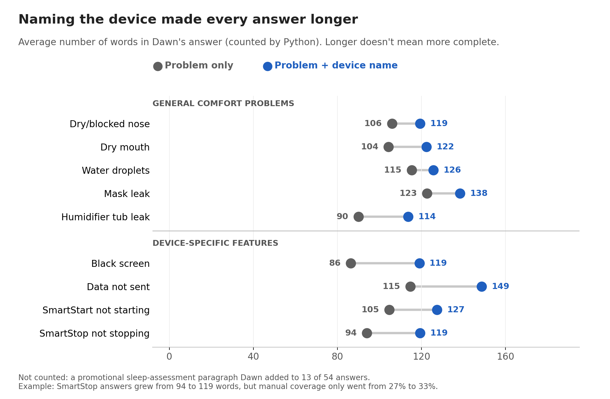

# CPAP Troubleshooting Response Analysis

## About

Part of a human factors portfolio case study evaluating whether Resmed’s AI assistant, Dawn, gives the same troubleshooting guidance as the Resmed AirSense 11 user manual.

Nine troubleshooting problem statements from the manual (p.18) were each entered into Dawn under two conditions:

- **Problem only:** the problem statement word for word from the manual (3 runs)
- **Problem + device name:** the same statement followed by “I have Resmed Airsense 11 CPAP machine.” (3 runs)

(In `hand_scores.csv`, these conditions are labeled `Plain` and `Device named`.)

That’s 9 statements × 2 conditions × 3 runs = 54 responses, each scored against the manual’s causes and solutions.

**Author:** Alyssa Mendes, MS Human Factors student, Embry-Riddle Aeronautical University

**My role:** I designed the study, collected all 54 responses, built the answer
key from the AirSense 11 manual, and made the final scoring decisions. An AI
assistant (Claude) applied the predefined yes/no scoring rules for a first-pass
draft. I reviewed the borderline cases and revised four of the rules (for
example, counting “use a heated tube” as addressing tube temperature) before
finalizing the scores.

The analysis scripts were developed with AI coding assistants (Claude, GitHub
Copilot) and checked against hand-calculated expected results. Hand scores were
drafted with AI assistance using predefined yes/no rules and reviewed by the
author. This is an independent student project, not affiliated with or endorsed
by ResMed, and not conducted through, sponsored by, or reviewed by Embry-Riddle
Aeronautical University. Responses were collected in November 2026; Dawn's
answers may have changed since.

This project extracts 54 troubleshooting responses from a PDF, measures each
response's length and key-term coverage, and produces summary tables and charts.
A separate scoring script combines the analysis with human-entered hand scores
to calculate manual coverage and issue counts.

The source PDF and generated response-data CSVs are excluded from the repository
because they contain source material or response text. The hand-score file and
summary chart images are included. Keep the source PDF in this folder locally
before running extraction.

## Files

- `extract.py` reads the PDF and writes the 54 parsed responses to
  `responses.csv`.
- `analyze.py` measures response lengths and statement-specific key-term
  matches, prints summary tables, and writes `results.csv`.
- `case_study_charts.py` reads `hand_scores.csv` and `results.csv`, then creates
  the five case-study charts listed below.
- `scores.py` joins `hand_scores.csv` with `results.csv`, recalculates manual
  coverage, and prints hand-score summary tables.
- `hand_scores.csv` contains the human ratings used by the case-study charts.
- `requirements.txt` lists the Python packages used by the scripts.
- `.gitignore` excludes the PDF, response-data CSVs, spreadsheet files, and
  virtual environment while allowing the hand scores and chart PNGs.

## Setup

Use Python 3.9 or later. From this folder, create and activate a virtual
environment, then install the dependencies:

```bash
python3 -m venv .venv
source .venv/bin/activate
python -m pip install -r requirements.txt
```

On Windows, activate the environment with:

```powershell
.venv\Scripts\Activate.ps1
```

Place the source PDF, named `AI-CPAP Troubleshooting Statements.pdf`, in this
folder. The included `hand_scores.csv` is used by the charting step.

## How to run

Run these scripts in order from the project folder:

```bash
python extract.py
python analyze.py
python case_study_charts.py
```

The extraction and analysis scripts create `responses.csv` and `results.csv`.
These generated CSVs are ignored because they contain response text or derived
response data.

## Findings



*Naming the device mostly helped on device-specific problems (Data not sent, SmartStart), but coverage dropped for Black screen.*



*Without the device name, 18 of 27 answers referred to the wrong device or assumed a mask the user never mentioned; with it, 9 of 27 did.*



*Dawn linked the AirSense 11 manual in 0 of 27 answers without the device name and 16 of 27 with it.*

## How I checked my work (automated text analysis in Python)



*A Python keyword search mostly agreed with my hand scores. It matches words, not meaning, so it supports the hand scores rather than replacing them.*



*Every answer got longer when the device was named, but longer did not always mean more complete (SmartStop: 94 to 119 words, coverage 27% to 33%).*
## Limitations

- Exploratory study: 9 problems, 3 tries per problem per wording (54 answers).
  Differences were not statistically significant at this sample size; results
  are patterns to test, not proven effects.
- Scored against one source (the AirSense 11 user manual, page 18
  troubleshooting table).
- Dawn's answers can change over time; responses were collected November 2026.
- Severity of potential harms has not been clinically reviewed.

The Python analysis excludes a promotional sleep-assessment paragraph Dawn
added to 13 of 54 answers (excluded from word counts).
