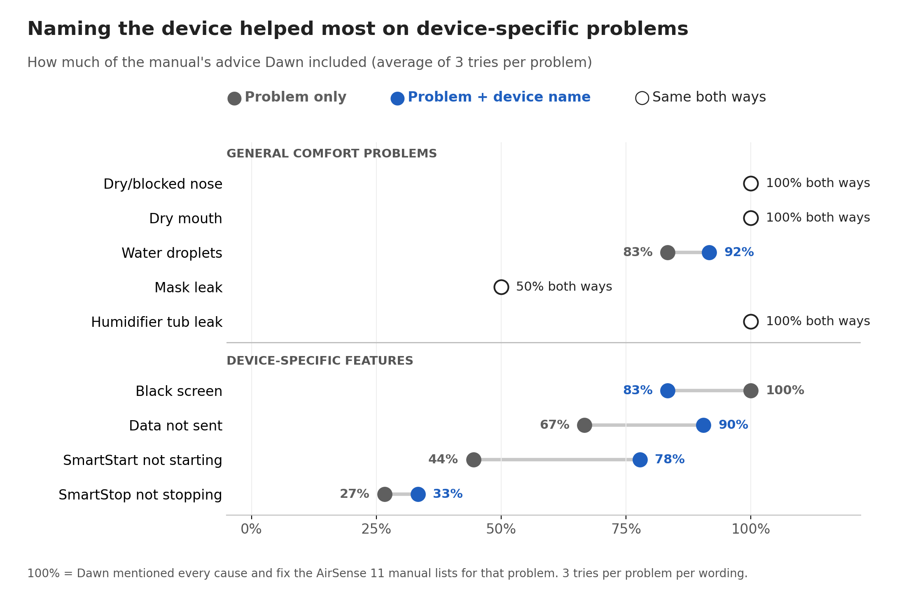
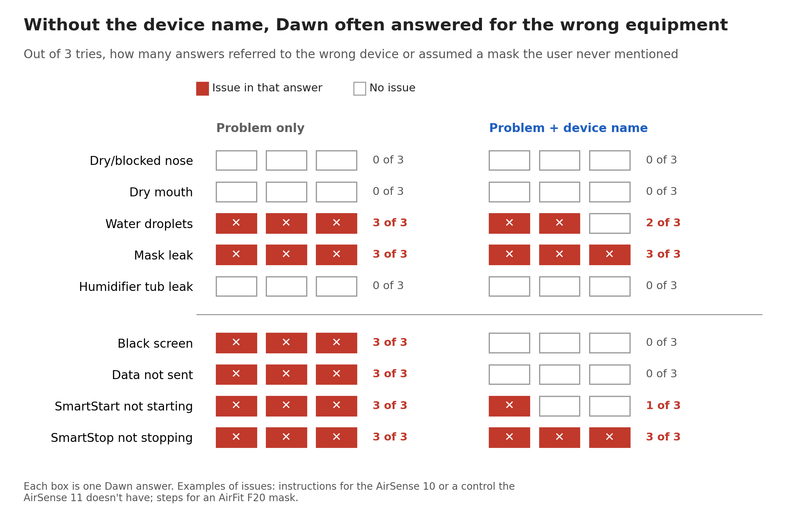
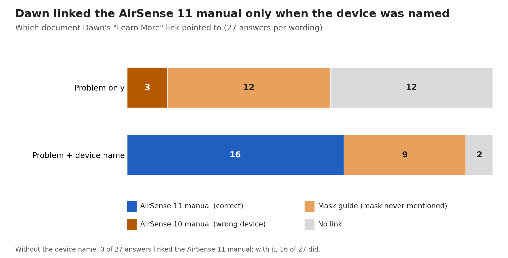
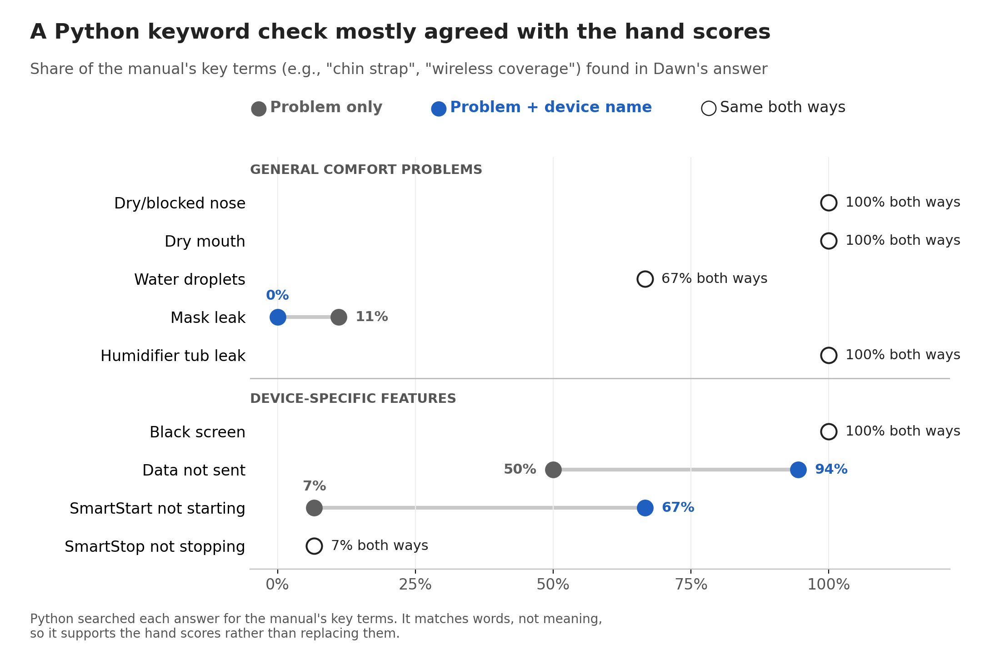
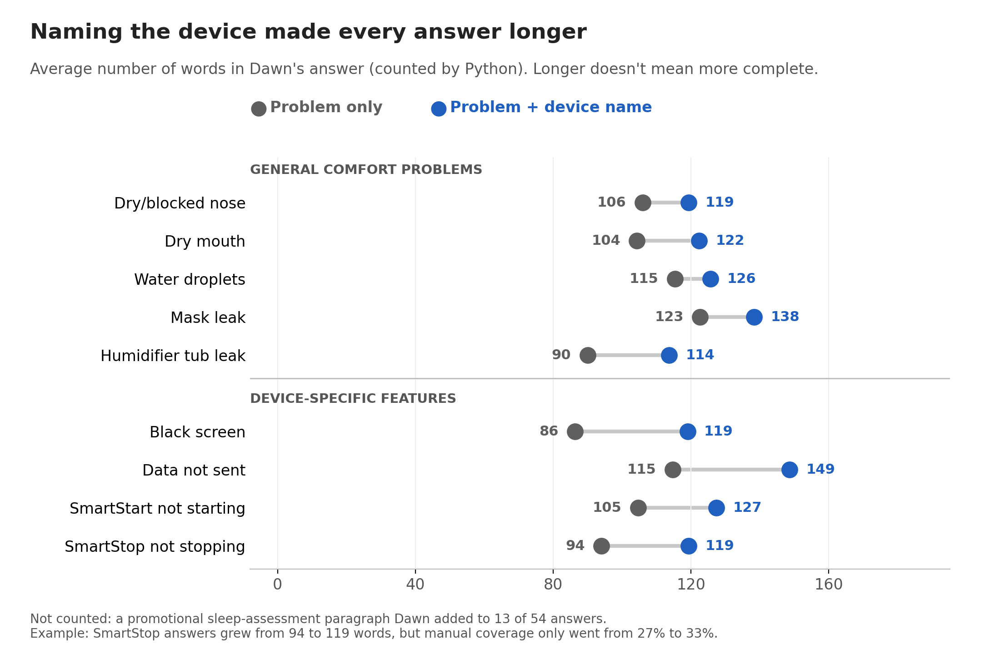

# Does ResMed's AI Assistant Match the CPAP Manual?

*This was an independent student project for my portfolio. This case study is not affiliated with or endorsed by ResMed, and not conducted through, sponsored by, or reviewed by Embry-Riddle Aeronautical University.*

**Author:** Alyssa Mendes, MS Human Factors student at Embry-Riddle Aeronautical University

## Overview

The purpose of this case study was to evaluate a user interface, AI online customer support, for the ResMed AirSense 11. The AirSense 11 is a family of Continuous Positive Airway Pressure devices, also known as CPAP devices/machines (AirSense 11 user guide, Welcome section). The instructions for use, or IFU, were used to evaluate whether ResMed's generative AI, Dawn, would give answers that match the manual.

## Method

For the ResMed AirSense 11, the user manual serves as the IFU. On page 18, the user manual lists troubleshooting statements. Each of these statements has causes and possible solutions to help patients who are experiencing difficulties with their devices. Nine of these problem statements were entered into ResMed's Dawn AI under two conditions, each repeated three times:

- **Problem only:** The troubleshooting/problem statement word for word from the manual.
- **Problem + device name:** The same troubleshooting/problem statement followed by "I have Resmed Airsense 11 CPAP machine."

*In hand_scores.csv, these conditions are labeled Plain and Device named.*

9 statements × 2 conditions × 3 runs = 54 responses. Each response was individually scored against the manual's possible causes and possible solutions.

Responses were collected in November 2026. Since then, Dawn's programming may have been updated and answers may have changed.

## My role

I designed the case study. I used the user manual to list the problem statements, possible causes, and possible solutions. I collected and recorded 54 responses using ResMed's official website. I used a private Safari window on a MacBook Pro. Each time, I googled "ResMed" as customers would, clicked on the ResMed website, denied the cookies, clicked on the bottom right button (where there are two sparkle icons), and agreed to the terms and conditions for Dawn AI. After the statement was entered, I pressed enter and copied the response. I then closed the tab and restarted to minimize the risk of Dawn having a stored memory. It was not possible to confirm that Dawn did not have stored memory. After collecting the 54 responses, I built an answer key. I used Claude AI to do a yes/no scoring of each response. Afterwards, I went through each one and made changes depending on whether I agreed with the scoring. One example was Claude AI saying that "use a heated tube" did not address the tube temperature. I disagreed and changed the scoring to count it.

The analysis scripts were developed with AI coding assistants (Claude, GitHub Copilot) and checked against my own expected results and scoring. The purpose of using these AI assistants was to build skills using AI tools. I used my own checks on the output to analyze AI limitations. I applied my knowledge of human factors and research design.

## Findings



*Naming the device mostly helped on device-specific problems (Data not sent, SmartStart), but coverage dropped for Black screen.*



*Without the device name, 18 of 27 answers referred to the wrong device or assumed a mask the user never mentioned; with it, 9 of 27 did.*



*Dawn linked the AirSense 11 manual in 0 of 27 answers without the device name and 16 of 27 with it.*

## How I checked my work (automated text analysis in Python)



*A Python keyword search mostly agreed with my hand scores. It matches words, not meaning, so it supports the hand scores rather than replacing them.*



*Every answer got longer when the device was named, but longer did not always mean more complete (SmartStop: 94 to 119 words, coverage 27% to 33%).*

## Limitations

- Exploratory study: 9 problems, 3 tries per problem per wording (54 answers).
  Differences were not statistically significant at this sample size; results
  are patterns to test, not proven effects.
- Scored against one source (the AirSense 11 user manual, page 18
  troubleshooting table).
- Dawn's answers can change over time; responses were collected November 2026.
- Severity of potential harms has not been clinically reviewed.

The Python word counts exclude a promotional sleep-assessment paragraph Dawn
added to 13 of 54 answers.

## Repository files and how to run

This project extracts 54 troubleshooting/problem responses from a PDF of the collected responses, measures each response's length and key-term coverage, and produces summary tables. A separate scoring script combines the analysis with human-entered hand scores to calculate manual coverage and issue counts, and `case_study_charts.py` creates the charts.

The source PDFs (the user manual and the collected responses) and generated response-data CSVs are excluded from the repository because they contain source material or response text. The hand-score file and chart images are included. Keep the source PDFs in this folder locally before running extraction.

### Files

- `extract.py` reads the PDF and writes the 54 parsed responses to
  `responses.csv`.
- `analyze.py` measures response lengths and statement-specific key-term
  matches, prints summary tables, and writes `results.csv`.
- `case_study_charts.py` reads `hand_scores.csv` and `results.csv`, then creates
  the five case-study charts shown above.
- `scores.py` joins `hand_scores.csv` with `results.csv`, recalculates manual
  coverage, and prints hand-score summary tables.
- `hand_scores.csv` contains the human ratings used by the case-study charts.
- `requirements.txt` lists the Python packages used by the scripts.
- `.gitignore` excludes the PDF, response-data CSVs, spreadsheet files, and
  virtual environment while allowing the hand scores and chart PNGs.

### Setup

Use Python 3.9 or later. From this folder, create and activate a virtual
environment, then install the dependencies:

```bash
python3 -m venv .venv
source .venv/bin/activate
python -m pip install -r requirements.txt
```

On Windows, activate the environment with:

```powershell
.venv\Scripts\Activate.ps1
```

Place the source PDF, named `AI-CPAP Troubleshooting Statements.pdf`, in this
folder. The included `hand_scores.csv` is used by the charting step.

### How to run

Run these scripts in order from the project folder:

```bash
python extract.py
python analyze.py
python case_study_charts.py
```

The extraction and analysis scripts create `responses.csv` and `results.csv`.
These generated CSVs are ignored because they contain response text or derived
response data.
